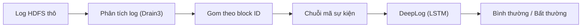

# Project III — Phát hiện bất thường trong log hệ thống bằng DeepLog (HDFS_v1)

Mục tiêu: parse log HDFS → tạo chuỗi sự kiện theo block → train DeepLog (LSTM)
→ phát hiện bất thường bằng luật top-g → so sánh với một phương pháp cổ điển (PCA / Isolation Forest).

**Trạng thái: tuần 5** — phát hiện theo luồng: demo phát lại log theo thời gian, cảnh báo kèm lý do, kiểm tra trùng kết quả
offline ở mọi block; tính lại kết quả và độ trễ theo quy tắc không dùng sự kiện tương lai;
cách chấm mới của DeepLog (độ bất ngờ trộn tần suất), phản hồi người vận hành, đối chứng không học sâu.
Tuần 4: luật bất biến học từ session Normal (sự kiện lạ, nhân bản đúng hạn) kết hợp với DeepLog;
chỉ số vận hành: cảnh báo giả mỗi giờ, độ trễ phát hiện, tỉ lệ báo nhầm theo thời gian; độ ổn định theo seed,
ghép 5 model DeepLog, đối chứng chia random; recall theo ngân sách cảnh báo giả; độ phủ thời gian của dữ liệu train;
bảng kết quả sinh tự động.
Tuần 3: cài và huấn luyện DeepLog bằng PyTorch, phát hiện bất thường bằng luật top-g, chọn ngưỡng
của mọi phương pháp (g của DeepLog, PCA, Isolation Forest) theo cùng một cách trên tập tune, phân tích lỗi.
Tuần 2: parse HDFS_v1 bằng Drain3 (khớp 100% với Loghub), dựng chuỗi theo block, EDA, chia dữ liệu theo thời gian,
baseline PCA / Isolation Forest.
Ghi chú tìm hiểu tuần 1 (bài toán, DeepLog, HDFS_v1, phạm vi, các quyết định): [documents/TUAN1_TIM_HIEU.md](documents/TUAN1_TIM_HIEU.md).

Pipeline:



## 1. Cấu trúc thư mục

```
project-3/
├── configs/
│   ├── config.yaml          # toàn bộ đường dẫn + tham số (đọc qua src/config.py)
│   ├── config_random.yaml   # TUẦN 4: như trên nhưng chia random, kết quả ghi vào thư mục riêng
│   ├── drain3_basic.ini     # TUẦN 1: Drain3 cơ bản, chỉ che mã block, IP, con số
│   └── drain3.ini           # TUẦN 2: Drain3 đã chỉnh cho HDFS_v1 (29 template)
├── data/                    # không đưa lên GitHub
│   ├── raw/                 # HDFS_2k/, HDFS_v1/ (tự tải về, xem mục 3)
│   ├── interim/             # kết quả bước 1: log có cấu trúc, bảng template, block_stats.csv
│   └── processed/           # kết quả bước 2–3: sessions.pkl, event_index.json, splits/
├── documents/
│   └── TUAN1_TIM_HIEU.md    # TUẦN 1: ghi chú tìm hiểu tài liệu và bộ dữ liệu
├── notebooks/
│   └── 01_eda_hdfs.ipynb    # TUẦN 2: khám phá dữ liệu (EDA)
├── src/
│   ├── config.py            # đọc config.yaml
│   ├── utils.py             # seed, chọn device (MPS/CUDA/CPU), logger, JSON
│   ├── explore_hdfs_2k.py   # TUẦN 1: khảo sát HDFS_2k bằng Drain3
│   ├── parse_logs.py        # BƯỚC 1: parse log thô bằng Drain3
│   ├── build_sequences.py   # BƯỚC 2: gom sự kiện thành chuỗi theo block, gắn nhãn
│   ├── split_data.py        # BƯỚC 3: chia train / val / test
│   ├── dataset.py           # TUẦN 3: cửa sổ trượt h sự kiện + Dataset PyTorch (pad session ngắn)
│   ├── model.py             # TUẦN 3: mô hình DeepLog (Embedding → LSTM 2 lớp → Linear); tuần 4: ghép nhiều model
│   ├── train.py             # BƯỚC 4: train DeepLog, early stopping theo val loss
│   ├── detect.py            # BƯỚC 5: phát hiện bằng luật top-g
│   ├── baselines.py         # BƯỚC 6: PCA, Isolation Forest (ngưỡng mặc định)
│   ├── deeplog_scores.py    # BƯỚC 7a: rank của sự kiện thật ở mọi vị trí → kết quả của mọi g
│   ├── model_selection.py   # BƯỚC 7b: chọn phương án + ngưỡng trên tập tune, báo cáo trên tập eval
│   ├── evaluate.py          # precision / recall / F1, ROC-AUC, AP, recall theo nhóm, phân tích lỗi
│   ├── block_context.py     # BƯỚC 8a: thời điểm từng sự kiện + datanode của từng block (từ log thô)
│   ├── hybrid_detect.py     # BƯỚC 8b: luật bất biến + DeepLog; cảnh báo giả/giờ, độ trễ, drift
│   ├── plot_results.py      # BƯỚC 8c: hình kết quả (outputs/figures/fig_*.png)
│   ├── seed_study.py        # BƯỚC 9: train lại DeepLog với 5 seed, chạy lại bước 7–8
│   ├── ensemble.py          # BƯỚC 10: ghép 5 model của bước 9 (trung bình xác suất)
│   ├── operating_point.py   # BƯỚC 11: recall khi giới hạn số cảnh báo giả mỗi giờ
│   ├── time_coverage.py     # độ phủ thời gian: train trên 9 phút / 2 giờ / 3,5 giờ đầu
│   ├── report_tables.py     # bảng kết quả tổng hợp mọi seed, cách chia, cách tune
│   ├── audit_results.py     # kiểm tra nguồn gốc file kết quả
│   ├── stream_offline.py    # BƯỚC 12 (tuần 5): kết quả offline theo quy tắc chạy được theo luồng
│   ├── stream_detector.py   # TUẦN 5: bộ phát hiện theo luồng (DeepLog ghép + hai luật), không nhìn tương lai
│   ├── stream_compare.py    # BƯỚC 15 (tuần 5): độ bất ngờ trộn tần suất, luật hiếm, Markov, phản hồi; chốt trên holdout
│   ├── stream_feedback.py   # BƯỚC 14 (tuần 5): chờ xác nhận + phản hồi người vận hành, đối chứng n-gram
│   ├── stream_demo.py       # BƯỚC 13 (tuần 5): demo phát lại log, kiểm tra demo = offline, đo tốc độ
│   ├── block_stats.py       # vị trí, thời gian, nhãn của từng block
│   └── validate_parsing.py  # so kết quả parse với đáp án Loghub
├── outputs/
│   ├── figures/             # hình (fig_*.png: kết quả bước 8; figures/random/: bản chia random)
│   ├── models/              # checkpoint DeepLog (.pt), không đưa lên GitHub
│   └── results/             # file JSON/CSV kết quả (mỗi file JSON có mục `meta`: commit, config đã dùng)
├── tests/                   # TUẦN 4: kiểm thử tự động (python -m unittest discover -s tests)
├── scripts/run_pipeline.sh  # chạy bước 1–11 + phân tích lỗi
├── requirements.txt
└── README.md
```

## 2. Cài đặt

```bash
cd ~/project-3
python3 -m venv venv
source venv/bin/activate
pip install -r requirements.txt
python -c "import torch; print(torch.__version__, 'MPS:', torch.backends.mps.is_available())"
```

Dòng cuối in `MPS: True` nghĩa là PyTorch dùng được GPU của Mac; nếu không, `train.device: auto` tự lùi về CUDA hoặc CPU.

## 3. Tải dữ liệu

**Bộ mẫu HDFS_2k** (khảo sát tuần 1, từ GitHub `logpai/loghub`):

```bash
mkdir -p data/raw/HDFS_2k && cd data/raw/HDFS_2k
for f in HDFS_2k.log HDFS_2k.log_structured.csv HDFS_2k.log_templates.csv; do
  curl -sSfLO https://raw.githubusercontent.com/logpai/loghub/master/HDFS/$f
done
cd ../../..
```

**Bộ đầy đủ HDFS_v1:** vào GitHub `logpai/loghub`, mục **HDFS**, theo link Zenodo để tải `HDFS_v1.zip`,
rồi giải nén vào `data/raw/HDFS_v1/`:

```bash
mkdir -p data/raw/HDFS_v1
unzip HDFS_v1.zip -d data/raw/HDFS_v1
ls -lh data/raw/HDFS_v1 data/raw/HDFS_v1/preprocessed
```

Cần có `HDFS.log` (~1,5GB, 11.175.629 dòng) và trong `preprocessed/`: `anomaly_label.csv` (nhãn của từng block),
`HDFS.log_templates.csv`, `Event_traces.csv`. Hai file sau là kết quả parse của Loghub, chỉ dùng để kiểm tra.

## 4. Chạy

Luôn chạy bằng `python -m src.<tên_module>` từ thư mục `~/project-3`, vì các file import nhau theo dạng `from src.xxx import ...`.

```bash
python -m src.explore_hdfs_2k   # TUẦN 1: khảo sát bộ mẫu
python -m src.parse_logs        # BƯỚC 1: parse HDFS.log bằng Drain3
python -m src.build_sequences   # BƯỚC 2: chuỗi sự kiện theo block
python -m src.block_stats       # ~10 giây, cần cho validate_parsing và notebook EDA
python -m src.validate_parsing  # so kết quả bước 1–2 với đáp án Loghub
python -m src.split_data        # BƯỚC 3: chia train / val / test
jupyter notebook notebooks/01_eda_hdfs.ipynb
python -m src.train             # BƯỚC 4: train DeepLog (~15 giây trên Mac M-series)
python -m src.detect            # BƯỚC 5: top-g với g = detect.top_g (thử nhanh: --max-sessions 20000)
python -m src.detect --top-g 7  # g khác, ghi ra deeplog_metrics_g7.json, deeplog_predictions_g7.pkl
python -m src.evaluate --top-g 7  # phân tích lỗi + recall theo 2 nhóm bất thường
python -m src.baselines         # BƯỚC 6: PCA và Isolation Forest
python -m src.deeplog_scores    # BƯỚC 7a: rank DeepLog → kết quả của mọi g, không chạy lại model
python -m src.model_selection --tune-mode earliest   # BƯỚC 7b (chạy cả --tune-mode random)
python -m src.block_context     # BƯỚC 8a (~40 giây, quét log thô 1 lần)
python -m src.hybrid_detect     # BƯỚC 8b: luật bất biến + DeepLog (cần bước 7 chạy trước)
python -m src.plot_results      # BƯỚC 8c: hình kết quả
python -m src.seed_study        # BƯỚC 9 (~4 phút mỗi seed)
python -m src.ensemble          # BƯỚC 10 (~2 phút, cần bước 9)
python -m src.operating_point --tune-mode random   # BƯỚC 11 (chạy cả --tune-mode earliest; --all-runs cho mọi seed + ensemble)
python -m src.time_coverage --run                  # độ phủ thời gian (train lại 5 seed cho mỗi cấu hình)
python -m src.report_tables                        # bảng tổng hợp ở outputs/report_tables/
python -m src.stream_offline                       # BƯỚC 12 (~1 phút, cần bước 9–10)
python -m src.stream_demo --start-hour 31 --speed 600 --max-alerts 20 --show-labels   # BƯỚC 13: demo
python -m src.stream_demo --source log --speed 0   # demo đọc log thô (200 nghìn dòng đầu)
python -m src.stream_feedback                      # BƯỚC 14 (~3 phút, sau bước 12)
python -m src.stream_compare                       # BƯỚC 15 (~5 phút, cần bước 9–10)
python -m src.stream_demo --verify                 # phát lại toàn bộ, so từng block với bước 12 (~30 giây)
python -m unittest discover -s tests               # kiểm thử
```

Hoặc chạy bước 1–15 và phân tích lỗi liên tiếp: `bash scripts/run_pipeline.sh`.
Đối chứng chia random: `bash scripts/run_pipeline.sh configs/config_random.yaml` (kết quả ở
`data/processed/splits_random/`, `outputs/models/random/`, `outputs/results/random/`).

**Nguồn gốc kết quả:** mọi file JSON kết quả có mục `meta` (thời điểm, commit git, toàn bộ config). Checkpoint
DeepLog lưu cấu hình lúc train; các bước sau in cảnh báo nếu checkpoint được train với cấu hình khác config hiện tại.

**Chạy thử nhanh:** trong `configs/config.yaml`, đặt `parse.max_lines: 200000` để chỉ parse 200 nghìn dòng đầu.
Khi mọi bước chạy thông suốt, đổi lại `max_lines: null` để chạy toàn bộ dữ liệu.

## 5. Kết quả đúng phải là

**Khảo sát HDFS_2k (tuần 1)** — `outputs/results/hdfs2k_survey.json`, `hdfs2k_templates.csv`, `outputs/figures/hdfs2k_template_freq.png`:
- 2.000 dòng, không dòng nào lệch định dạng: 1.920 INFO, 80 WARN, 6 component.
- Drain3 cơ bản tìm được 16 template, đáp án Loghub có 14 (template "BLOCK* ask ... to delete ..." bị tách theo số mã block).
- 2.194 trên 2.200 mã block chỉ có 1 dòng, nên bộ mẫu không dựng được chuỗi theo block.

**Parse HDFS_v1 (bước 1–2)** — `outputs/results/parsing_validation.json`, `drain_vs_reference.csv`:
- 11.175.629 dòng, 29 template (khớp 29 template của Loghub), `grouping_accuracy = 1.0`.
- 575.061 block (16.838 bất thường), chuỗi sự kiện khớp chính xác `Event_traces.csv` ở cả 575.061 block (`match_rate = 1.0`).
- Vì kết quả parse khớp hoàn toàn, không cần phương án dự phòng (dùng chuỗi đã tiền xử lý của Loghub) ở mục 8 báo cáo tuần 1.
- Nếu `parse_logs` cho kết quả khác thì lỗi nằm ở code parse, không phải ở cấu hình Drain3.
- So với `drain3_basic.ini` (45 template, grouping accuracy 0,85), `drain3.ini` che thêm exception, đường dẫn file,
  danh sách IP và tăng `sim_th` lên 0,9 (giải thích trong file).

**Chia dữ liệu (bước 3)** — `data/processed/splits/summary.json`:
- train 5.024 + val 558 session, toàn bộ là Normal: 1% session Normal *sớm nhất*, thực tế chỉ là 9 phút log đầu
  (20:35 → 20:45 ngày 09/11/2008).
- test 569.276 session (16.635 bất thường), kéo dài khoảng 38,5 giờ. 203 session bất thường bắt đầu trước mốc cắt bị bỏ,
  để test chỉ chứa "tương lai".
- Notebook EDA giải thích vì sao chọn cách chia này và các đặc điểm của dữ liệu (độ dài session, bất thường theo thời gian,
  sự kiện chỉ có ở session bất thường, chuỗi trùng lặp). Hình lưu ở `outputs/figures/eda_*.png`.

**Baseline (bước 6)** — `outputs/results/baselines.json`. Mỗi phương pháp được fit theo 2 cách: trên session Normal của
train + val (cùng dữ liệu DeepLog sẽ dùng), hoặc trên 10% session sớm nhất của test **bỏ nhãn** (log không nhãn,
3,5 giờ ngay sau train). Cả 4 cách chấm trên cùng tập eval: 90% test còn lại (512.348 session, 14.027 bất thường).

| Phương pháp | Fit trên | Precision | Recall | F1 | ROC-AUC | AP |
|---|---|---|---|---|---|---|
| PCA | session Normal | 0,747 | 0,830 | 0,786 | 0,932 | 0,810 |
| PCA | log không nhãn | 0,172 | 0,753 | 0,280 | 0,902 | 0,507 |
| Isolation Forest | session Normal | 0,028 | 0,987 | 0,054 | 0,578 | 0,112 |
| Isolation Forest | log không nhãn | 0,936 | 0,537 | 0,683 | 0,977 | 0,865 |

- ROC-AUC, AP không phụ thuộc ngưỡng (AUC = 0,5 là đoán mò). P/R/F1 dùng ngưỡng mặc định, chưa chỉnh theo nhãn.
- Isolation Forest fit trên session Normal gần như đoán mò: cây chỉ cắt được trên 12/29 loại sự kiện có thay đổi trong
  train, trong khi 60% session bất thường chứa sự kiện chưa từng xuất hiện trong train (mục `diagnostics`).
- PCA thì ngược lại: TF-IDF cho sự kiện chưa từng thấy trọng số rất lớn, nên fit trên session Normal cho kết quả tốt nhất.

**Train DeepLog (bước 4)** — `outputs/models/deeplog_best.pt`, `outputs/results/train_history.json`:
- Mô hình theo bài báo: cửa sổ h = 10, Embedding 32 chiều → LSTM 2 lớp × 64 đơn vị → Linear 30 lớp (29 sự kiện + PAD),
  61.278 tham số. Session có ≤ h sự kiện được thêm PAD vào đầu nên vẫn có 1 cửa sổ (notebook EDA, Phần 2).
- 80.619 cặp (cửa sổ, sự kiện kế tiếp) từ 5.024 session train, 8.329 cặp từ 558 session val.
- Adam, lr = 0,001, batch 512, seed 42. Early stopping dừng ở epoch 11; val loss thấp nhất 0,210 ở epoch 6.

**Phát hiện top-g (bước 5)** — `outputs/results/deeplog_metrics_g{g}.json` (toàn bộ test, 569.276 session):

| g | Precision | Recall | F1 | FP | FN |
|---|---|---|---|---|---|
| 5 | 0,708 | 0,998 | 0,829 | 6.832 | 30 |
| 7 | 0,847 | 0,993 | 0,914 | 2.985 | 122 |
| 9 (bài báo) | 0,839 | 0,861 | 0,850 | 2.754 | 2.311 |
| 11 | 0,838 | 0,747 | 0,790 | 2.400 | 4.208 |
| 15 | 0,910 | 0,596 | 0,720 | 984 | 6.719 |

- Bảng chỉ để xem độ nhạy theo g; g dùng để báo cáo được chọn trên tập tune ở bước 7 (không chọn theo F1 trên test).
- Phân tích lỗi ở g = 7 (`python -m src.evaluate --top-g 7` → `error_analysis_g7.csv`):
  119/122 FN chứa sự kiện chưa từng có trong train (chủ yếu E15 "Receiving empty packet") nhưng chỉ nằm trong 10 sự kiện
  đầu, phần mà cách cắt cửa sổ của DeepLog không bao giờ dự đoán. 1.778/2.985 FP là session Normal có nhân bản lại block
  (E6–E9; chỉ 1/5.582 session train có); trong số còn lại, 218 FP chứa sự kiện chưa từng thấy (chủ yếu E23) và 269 FP
  bị đọc (E10) từ 4 lần trở lên, trong khi trung vị ở train là 1.

**Chọn phương án công bằng (bước 7)** — `outputs/results/model_selection_{earliest,random}.json`.
Test chia làm tập tune (10%, có nhãn, chỉ để chọn phương án và ngưỡng) và tập eval (90%, 512.348 session, chỉ để báo cáo).
Ngưỡng của MỌI phương pháp là ngưỡng cho F1 cao nhất trên tune; điểm của DeepLog là rank lớn nhất của sự kiện thật
trong session, nên "max rank > g" chính là luật top-g. F1 trên eval (seed 42):

| Phương pháp | Fit trên | Tune ngẫu nhiên | Tune sớm nhất |
|---|---|---|---|
| DeepLog (g chọn được = 7 ở cả hai) | 5.582 session Normal | 0,915 | 0,903 |
| PCA | 5.582 session Normal | 0,848 | 0,172 |
| PCA | tập tune, không dùng nhãn | 0,973* | 0,213 |
| Isolation Forest | 5.582 session Normal | 0,258 | 0,254 |
| Isolation Forest | tập tune, không dùng nhãn | 0,713 | 0,829 |

\* Tập tune ngẫu nhiên rải khắp thời gian test, nên phương án này đã thấy log (không nhãn) của tương lai: chỉ là cận trên.

- Cùng dữ liệu fit và tune ngẫu nhiên (seed 42): DeepLog 0,915, PCA 0,848. Tune trên 3,5 giờ đầu: ngưỡng PCA không dùng
  được về sau (báo nhầm hơn 100 nghìn session), còn g = 7 của DeepLog vẫn dùng được.
- ROC-AUC của DeepLog trên eval: 0,997 ở seed 42; trung bình 5 seed ở bước 9–10.
- Recall theo 2 nhóm bất thường của EDA (`recall_structural` / `recall_sequence`): DeepLog (seed 42) 0,988 / 0,997;
  PCA fit trên Normal 0,569 / 0,996 (bỏ sót toàn bộ 2.601 session chỉ có `E2 E1` hoặc `E1 E2`).
- Độ dao động theo seed và số trung bình 5 seed: xem bước 9–10 bên dưới.

**Luật bất biến và bộ phát hiện kết hợp (bước 8)** — `outputs/results/hybrid_detection.json`, `hybrid_deadline.csv`,
`hybrid_drift.csv`, `outputs/figures/fig_*.png`. `block_context.py` quét log thô một lần (~40 giây) để lấy thời điểm của
từng sự kiện. Hai luật học từ 5.582 session Normal của train + val, không dùng nhãn:
- Luật sự kiện lạ: train chỉ chứa 15/29 loại sự kiện. Session có sự kiện ngoài 15 loại này bị báo ngay khi sự kiện xuất hiện,
  kể cả trong 10 sự kiện đầu mà DeepLog không dự đoán.
- Luật nhân bản đúng hạn: mọi session Normal của train có ít nhất 3 lần E5 (`addStoredBlock: blockMap updated`, mỗi bản sao
  được lưu xong sinh 1 dòng), lần thứ 3 đến chậm nhất 352 giây sau sự kiện đầu. Session chưa đủ 3 lần E5 sau m × 352 giây bị
  báo; m ∈ {1, 2, 5, 10} chọn trên tập tune. Luật này bắt các session dừng giữa chừng như `E2 E1`.
- Kết hợp: báo nếu một trong hai luật hoặc DeepLog báo; m và g chọn cùng lúc trên tập tune theo F1.

Kết quả trên eval (seed 42, tune ngẫu nhiên; độ trễ tính từ sự kiện đầu tiên của block):

| Phương pháp | Precision | Recall | F1 | Cảnh báo giả / giờ | Độ trễ trung vị |
|---|---|---|---|---|---|
| DeepLog (g = 7) | 0,847 | 0,993 | 0,915 | 77 | 148 giây |
| Luật sự kiện lạ | 0,977 | 0,588 | 0,735 | 5,9 | 341 giây |
| Luật nhân bản đúng hạn | 0,978 | 0,384 | 0,551 | 3,7 | 704 giây |
| 2 luật | 0,972 | 0,776 | 0,863 | 9,6 | 704 giây |
| Kết hợp luật + DeepLog | 0,847 | 1,000 | 0,917 | 78 | 112 giây |
| PCA, cùng dữ liệu fit | 0,874 | 0,823 | 0,848 | 51 | 4.888 giây (chờ hết session) |

- Hai luật có ít cảnh báo giả nhất và không phụ thuộc seed. Độ trễ của DeepLog trong bảng này được đo trên session đã đủ
  sự kiện: session có từ 10 sự kiện trở xuống được chấm ở sự kiện cuối, điều mà hệ thống chạy theo luồng không biết trước.
  Số đo theo luồng ở bước 12–13 bên dưới thay cho nhận định "phát hiện sớm hơn nhiều" của bản tuần 4.
- Tỉ lệ báo nhầm theo từng khoảng 2 giờ (`hybrid_drift.csv`, `fig_drift.png`): DeepLog có hai đỉnh 2,4% (giờ 12–14) và
  1,8% (giờ 30–32), tức hành vi bình thường thay đổi so với đoạn train; hai luật ở mức ≤ 0,6% trừ khoảng giờ 12–14.
- Đã thử thêm điểm rủi ro theo datanode (`hybrid_node_risk`), nhưng điểm này không phân biệt được bất thường (ROC-AUC 0,47)
  nên không dùng.

**Độ ổn định theo seed và ghép 5 model (bước 9–10)** — `outputs/results/seed_study_summary.csv`, `ensemble_summary.csv`.
`seed_study.py` train lại DeepLog với seed 42, 1, 2, 3, 4 (giữ nguyên dữ liệu, tập tune, tập eval) rồi chạy lại bước 7–8;
`ensemble.py` lấy trung bình phân phối xác suất của 5 model rồi áp luật top-g như cũ (g chọn trên tune).
F1 trên eval, chia theo thời gian (cảnh báo giả mỗi giờ ghi theo tune ngẫu nhiên / sớm nhất):

| Phương pháp | Tune ngẫu nhiên | Tune sớm nhất | Cảnh báo giả / giờ |
|---|---|---|---|
| DeepLog, 1 model (trung bình 5 seed) | 0,840 ± 0,054 | 0,827 ± 0,061 | 70 / 99 |
| DeepLog, ghép 5 model | 0,889 | 0,885 | 75 / 84 |
| 2 luật | 0,863 | 0,855 | 9,6 / 6,6 |
| Kết hợp, 1 model (trung bình 5 seed) | 0,883 ± 0,025 | 0,853 ± 0,055 | 63 / 99 |
| Kết hợp, ghép 5 model | 0,893 | 0,889 | 74 / 85 |
| PCA, cùng dữ liệu fit | 0,848 | 0,172 | 51 / 3.900 |
| Isolation Forest, log không nhãn của tập tune | 0,731 ± 0,065 | 0,829 ± 0,004 | 112 / 14 |

- Kết hợp ≥ DeepLog ở cả 10 lần chạy (5 seed × 2 cách tune), độ lệch chuẩn nhỏ hơn.
- Cập nhật so với tuần 3: các số 0,915 / 0,903, ROC-AUC 0,997 và recall theo 2 nhóm ở bước 7 là của seed 42. Trung bình
  5 seed: F1 0,840 ± 0,054 / 0,827 ± 0,061 (từ 0,76 đến 0,92 theo seed), ROC-AUC 0,955 / 0,968 (từ 0,913 đến 0,997).
  Khi tune sớm nhất, F1 thấp nhất của DeepLog là 0,76, vẫn cao hơn nhiều PCA (0,172), và ngang Isolation Forest học
  trên log không nhãn (0,829). Batch 2048 (bản tuần 2–3) và batch 512 cho F1 trung bình tương đương
  (0,855 và 0,840 khi tune ngẫu nhiên).
- Nguồn dao động: 36,7% session bất thường có ≤ 10 sự kiện; với chúng DeepLog chỉ đoán sự kiện cuối từ cửa sổ gần như toàn
  PAD, loại cửa sổ chưa gặp khi train (session train ngắn nhất dài 22 sự kiện). Ghép 5 model làm mất phần tuỳ ý này.

**Đối chứng chia random** — `bash scripts/run_pipeline.sh configs/config_random.yaml` (kết quả ở `outputs/results/random/`,
không ghi đè bản chia theo thời gian). 5.582 session Normal của train + val lấy ngẫu nhiên trên cả 38 giờ:

| Phương pháp | Tune ngẫu nhiên | Tune sớm nhất |
|---|---|---|
| DeepLog, 1 model (trung bình 5 seed) | 0,776 ± 0,005 | 0,759 ± 0,011 |
| DeepLog, ghép 5 model | 0,782 | 0,768 |
| 2 luật | 0,698 | 0,639 |
| Kết hợp, 1 model (trung bình 5 seed) | 0,782 ± 0,006 | 0,754 ± 0,011 |
| PCA, cùng dữ liệu fit | 0,987 | 0,936 |

Khi train trải đều theo thời gian, PCA phù hợp hơn. Lợi thế của luật và DeepLog gắn với trường hợp train chỉ phủ một đoạn
ngắn trong quá khứ: khi chia theo thời gian, 59% session bất thường của eval có sự kiện chưa thấy khi train, khi chia
random chỉ 34–36%.

**Điểm vận hành theo ngân sách cảnh báo giả (bước 11)** — `outputs/results/operating_points_summary.csv`. Với ngân sách
B = 1, 5, 10, 25 cảnh báo giả mỗi giờ, mỗi phương pháp chọn trên tune tham số / ngưỡng bắt nhiều bất thường nhất mà không
vượt B, rồi chấm một lần trên eval; bộ kết hợp được phép tắt DeepLog. Chia theo thời gian, tune ngẫu nhiên, recall trên eval
(trong ngoặc: cảnh báo giả thực tế mỗi giờ):

| Phương pháp | B = 10 | B = 25 |
|---|---|---|
| DeepLog, 1 model (trung bình 5 seed) | 0,16 ± 0,20 (4,8) | 0,33 ± 0,31 (18,5) |
| DeepLog, ghép 5 model | 0,42 (10,2) | 0,68 (24,3) |
| 2 luật | 0,78 (9,6) | 0,78 (9,6) |
| Kết hợp, 1 model (trung bình 5 seed) | 0,78 (10,0) | 0,79 (18,0) |
| PCA, cùng dữ liệu fit | 0,59 (5,9) | 0,71 (15,4) |
| PCA, log không nhãn của tập tune* | 0,86 (10,6) | 1,00 (23,2) |

\* Tập tune ngẫu nhiên rải khắp 38 giờ nên chỉ là cận trên. Khi ngân sách được đặt trên 3,5 giờ đầu (tune sớm nhất), số
cảnh báo giả thực tế trên eval vượt ngân sách ở hầu hết phương pháp vì hành vi bình thường thay đổi theo thời gian;
ngưỡng cần được hiệu chỉnh định kỳ (mục 6).

**Độ phủ thời gian của dữ liệu train** — `python -m src.time_coverage --run`, kết quả ở `outputs/time_coverage/`
(`design.json`: thiết kế và độ phủ thực tế). Giữ nguyên 5.024 train + 558 val nhưng lấy mẫu session Normal bắt đầu trong
9 phút, 2 giờ hoặc 3,5 giờ đầu; validation là phần muộn nhất. Cả ba cấu hình dùng chung tập test (506.515 session bắt
đầu sau 00:27 ngày 10/11) và train lại đủ 5 seed. F1 trên eval (tune sớm nhất / tune ngẫu nhiên):

| Phương pháp | 9 phút đầu | 2 giờ đầu | 3,5 giờ đầu |
|---|---|---|---|
| DeepLog, 1 model (trung bình 5 seed) | 0,84 / 0,84 | 0,74 / 0,69 | 0,86 / 0,85 |
| DeepLog, ghép 5 model | 0,89 / 0,89 | 0,91 / 0,60 | 0,84 / 0,90 |
| 2 luật | 0,89 / 0,87 | 0,82 / 0,88 | 0,82 / 0,86 |
| Kết hợp, 1 model (trung bình 5 seed) | 0,88 / 0,88 | 0,85 / 0,85 | 0,85 / 0,89 |
| PCA, cùng dữ liệu fit | 0,12 / 0,84 | 0,18 / 0,84 | 0,18 / 0,84 |

- Ở cả ba khoảng, ngưỡng của PCA chọn trên 10% sớm nhất không dùng được về sau, còn luật, DeepLog và bộ kết hợp giữ được.
  Hai luật và bộ kết hợp có F1 bằng hoặc cao hơn PCA cùng dữ liệu ở cả 6 cấu hình.
- Ở khoảng 2 giờ với tune ngẫu nhiên, ghép 5 model cho F1 0,60, thấp hơn trung bình từng model; nguyên nhân chưa phân tích (mục 6).
- Cách chia chỉ dựa trên thời điểm *bắt đầu* session: sự kiện của các session train kéo dài tới khoảng giờ thứ 14 của log.

**Phát hiện theo luồng (bước 12–14, tuần 5)** — `outputs/results/stream/`: `offline.json`, `offline_summary.csv`,
`verify.json`, `feedback.json`, `feedback_table.csv`, `log_sample.json`, `demo_alerts.csv`. Khi log đang chảy, DeepLog chỉ
chấm được từ sự kiện thứ 11; session ngắn (37% bất thường của tập eval tune ngẫu nhiên, không có session Normal nào) do hai
luật phụ trách. Ngưỡng chọn trên 10% session sớm nhất; trong các m có F1 không khác nhau có ý nghĩa (bootstrap theo cặp) lấy
m nhỏ nhất. Tập "strict" gồm 453.152 session (10.943 bất thường) bắt đầu sau giờ 14,4, khi mọi session train / val / tune đã
kết thúc. DeepLog ghép 5 model, g = 7:

| Phương pháp (tập strict) | Precision | Recall | F1 | Cảnh báo giả / giờ | Độ trễ trung vị |
|---|---|---|---|---|---|
| DeepLog chấm cả session như tuần 3–4 (không chạy được theo luồng) | 0,809 | 0,992 | 0,891 | 105 | 358 giây |
| DeepLog theo luồng | 0,741 | 0,669 | 0,703 | 105 | 4.723 giây |
| 2 luật (m = 1) | 0,944 | 0,839 | 0,888 | 22 | 352 giây |
| 2 luật (m = 2) | 0,988 | 0,810 | 0,890 | 4,5 | 704 giây |
| Kết hợp theo luồng (m = 2) | 0,805 | 1,000 | 0,892 | 109 | 704 giây |
| Kết hợp + phản hồi sau 1 giờ + chờ xác nhận | 0,895 | 0,983 | 0,937 | 52 | 1.263 giây |
| Kết hợp + phản hồi sau 6 giờ + chờ xác nhận | 0,836 | 0,990 | 0,907 | 88 | 1.405 giây |
| Kết hợp + phản hồi sau 24 giờ + chờ xác nhận | 0,824 | 0,999 | 0,903 | 96 | 1.609 giây |
| *Đối chứng:* n-gram n = 2 + 2 luật, không phản hồi | 0,038 | 1,000 | 0,074 | 11.310 | 704 giây |
| *Đối chứng:* n-gram n = 2 + 2 luật + phản hồi sau 1 giờ + chờ | 0,888 | 0,996 | 0,939 | 57 | 1.560 giây |

- Không phản hồi: DeepLog bắt 2.073 trong 2.074 bất thường mà hai luật (m = 2) bỏ sót, đổi lại 2.536 cảnh báo giả. Nguyên nhân báo
  nhầm: tại lúc trượt top-g nhiều phiên bình thường và bất thường có đúng cùng 10 sự kiện; sự kiện E9 (sao chép lại block)
  chỉ có trong 1/5.582 session train.
- Phản hồi (bước 14): khi DeepLog trượt thì chờ tối đa k sự kiện / H giây rồi mới báo, mẫu đã được xác nhận bình thường thì
  thôi báo. Nhãn chỉ có cho block DeepLog đã báo và chỉ về sau khi session kết thúc + delay. k = 20, H = 3600 chọn trên tune.
  Trung bình 5 seed (strict): F1 0,857 ± 0,059 → 0,914 ± 0,036 (nhãn sau 1 giờ).
- Giới hạn: n-gram cùng cơ chế phản hồi đạt F1 tương đương trên strict (0,939), nên phần tăng chủ yếu nhờ phản hồi chứ không
  phải riêng học sâu. DeepLog hơn ở tập eval đầy đủ (0,923 so với 0,897) và hỏi người vận hành ít hơn (4.169 so với 6.441 lần
  trên toàn luồng). Với chia random, phản hồi không giúp (F1 0,768 → 0,763). Tinh chỉnh LSTM bằng phản hồi đã thử 4 cấu hình
  và không dùng: mỗi cấu hình đều làm sụp F1 ở đoạn đầu hoặc đoạn sau.
- Demo và bản chạy luồng có phản hồi trùng bản offline viết độc lập ở cả 569.276 block. Tốc độ lõi khoảng 600 nghìn sự
  kiện/giây, kể cả parse trên 200 nghìn dòng log thô khoảng 77 nghìn dòng/giây; log thật trung bình 80, cao nhất 5.173.
- Chuyển dòng log thô thành sự kiện theo template đã đóng băng: khớp chuỗi của bước 2 ở cả 15.639 block trong 200 nghìn
  dòng đầu (chưa chạy trên toàn bộ file log).

**So sánh cuối và cách chấm mới của DeepLog (bước 15)** — `<results_dir>/stream/compare.csv` của từng config. Tham số chọn trên tune; phần
`holdout` (phiên bắt đầu sau giờ 26) được chạy sau khi đã chốt các ứng viên, nhưng nó nằm trong tập strict mà bước 12–14 đã
xem cho các phương pháp trước, nên không hoàn toàn độc lập. Cách chấm mới: DeepLog báo theo độ bất ngờ −log p,
p = (1 − eps)·p_LSTM + eps·tần suất chung của sự kiện, thay cho xếp hạng top-g. Lý do: sự kiện hiếm có trong 1–3 session train
(E24, E23) lọt cả luật "chưa từng thấy" lẫn top-7. Đối chứng không học sâu: "luật hiếm" = báo sự kiện có trong ≤ c session
train (c chọn trên tune; trước đây khóa c = 0) và Markov cùng phép trộn. F1 (tập eval / holdout):

| Phương pháp | Chia thời gian | Chia ngẫu nhiên | Train 2 giờ đầu | Train 3,5 giờ đầu |
|---|---|---|---|---|
| Hai luật cũ (c = 0) | 0,856 / 0,914 | 0,671 / 0,645 | 0,873 / 0,895 | 0,873 / 0,894 |
| DeepLog xếp hạng + hai luật cũ | 0,886 / 0,872 | 0,768 / 0,710 | 0,873 / 0,894 | 0,906 / 0,877 |
| **DeepLog độ bất ngờ trộn + hai luật cũ** | 0,931 / 0,893 | 0,956 / 0,937 | 0,918 / 0,878 | 0,918 / 0,878 |
| Luật hiếm + hạn chờ (đối chứng) | 0,931 / 0,893 | 0,934 / 0,894 | 0,918 / 0,878 | 0,918 / 0,878 |
| Markov trộn tần suất + hai luật cũ (đối chứng) | 0,931 / 0,893 | 0,934 / 0,893 | 0,908 / 0,878 | 0,918 / 0,878 |

- So với DeepLog xếp hạng: hơn ở cả 4 cấu hình trên eval; trên holdout hơn rõ ở 2 cấu hình, bằng ở 1, thua ở 1 (0,878 so với 0,894).
- Chia thời gian, tập eval: cảnh báo giả 88 → 60 mỗi giờ so với DeepLog xếp hạng, sót 2 / 14.027 bất thường.
- Cấu hình duy nhất DeepLog hơn luật hiếm là chia ngẫu nhiên, nhưng ở đó 3.015 / 5.582 session train bắt đầu sau giờ 26, tức mạng
  đã thấy tương lai: kết quả này chỉ để tham khảo, KHÔNG phải bằng chứng cho phát hiện theo luồng.
- Hiệu F1 holdout (chia thời gian) giữa DeepLog độ bất ngờ và hai luật cũ: −0,016, khoảng tin cậy 95% [−0,19; 0,09] khi lấy mẫu lại
  theo giờ (11 giờ, báo nhầm dồn vào giờ 31). Không kết luận được bên nào hơn.
- So với luật hiếm: bằng ở 3 cấu hình, hơn ở chia ngẫu nhiên. Bản chất HDFS_v1 là phần lớn bất thường chứa một loại sự kiện hiếm,
  nên phép đếm đơn giản đã rất mạnh.
- Trên holdout, hai luật cũ cao nhất ở 3/4 cấu hình (0,914; 0,895; 0,894) vì ít báo nhầm nhất; báo nhầm của các cách còn lại tập trung
  vào E9, sự kiện chỉ có 1 session train, khi hành vi bình thường đổi (F1 phần phát triển 0,972 nhưng holdout 0,893).

Độ ổn định theo seed: F1 của MỘT model DeepLog + hai luật cũ, trung bình ± độ lệch chuẩn trên 5 seed (cột chia ngẫu nhiên chỉ để
tham khảo, lý do như trên):

| Cách chấm, tập | Chia thời gian | Chia ngẫu nhiên | Train 2 giờ đầu | Train 3,5 giờ đầu |
|---|---|---|---|---|
| Xếp hạng, eval | 0,854 ± 0,055 | 0,764 ± 0,014 | 0,887 ± 0,015 | 0,895 ± 0,020 |
| **Độ bất ngờ trộn, eval** | 0,924 ± 0,009 | 0,955 ± 0,004 | 0,916 ± 0,002 | 0,918 ± 0,000 |
| Xếp hạng, holdout | 0,873 ± 0,022 | 0,709 ± 0,004 | 0,884 ± 0,016 | 0,879 ± 0,008 |
| **Độ bất ngờ trộn, holdout** | 0,893 ± 0,000 | 0,936 ± 0,008 | 0,877 ± 0,002 | 0,878 ± 0,000 |

- Trên eval, cách chấm mới giảm độ lệch chuẩn ở cả 4 cấu hình và một model gần bằng ghép 5 model; trên holdout F1 trung bình tăng
  ở 2 cấu hình, giảm nhẹ ở 2 cấu hình.
- Phản hồi khái quát bằng biểu diễn LSTM (cosin trung bình trạng thái ẩn) trên DeepLog trộn, nhãn sau 1 giờ, so với khớp mẫu chính
  xác (holdout): 0,953 / 0,937 (thời gian), 0,911 / 0,935 (ngẫu nhiên), 0,939 / 0,918 (2 giờ), 0,900 / 0,918 (3,5 giờ). Không
  nhất quán nên KHÔNG đặt làm mặc định; hơn khớp chính xác khi có drift, kém hơn khi không.
- Đã thử và không dùng: cập nhật LSTM mỗi giờ bằng log chưa nhãn (phần phát triển 0,858, thua 0,902 của cách đứng yên); giải phóng
  trạng thái block theo khoảng lặng (block lặng tới 14,9 giờ, cắt ở 12 giờ làm sai 7.720 block).
- Demo dùng cách chấm mới: `python -m src.stream_demo --score mixed ...`; trùng offline ở 569.276 block.

**Bảng kết quả sinh tự động** — `python -m src.report_tables` đọc kết quả của mọi seed, ensemble, hai cách chia, hai cách
tune và ba cấu hình độ phủ, rồi ghi `outputs/report_tables/` (`tables.md`, `f1_same_training.csv`,
`operating_all_selected.csv`, ...). Biến thể và ngưỡng chỉ được chọn trên tập tune; script dừng nếu thiếu seed, cách tune
hoặc chỉ số. `python -m src.audit_results` kiểm tra nguồn gốc (mục `meta`) của các file kết quả và chuyển file không xác
minh được vào thư mục archive (không xoá). `python -m unittest discover -s tests` chạy 29 kiểm thử cho các bước chọn ngưỡng,
ngân sách cảnh báo giả, chia nhóm sự kiện lạ, thiết kế độ phủ thời gian và bộ phát hiện theo luồng.

## 6. Kế hoạch

| Tuần | Công việc |
|---|---|
| 1 | Tìm hiểu DeepLog, HDFS_v1; khảo sát HDFS_2k bằng Drain3 |
| 2 | Tải HDFS_v1, parse bằng Drain3, dựng chuỗi theo block, chia dữ liệu theo thời gian, phương pháp cổ điển |
| 3 | Cài đặt và train DeepLog, chọn g và ngưỡng của mọi phương pháp trên tập tune, phân tích lỗi (đã xong) |
| 4 | Độ ổn định theo seed; xử lý các điểm mù của DeepLog tìm được ở phân tích lỗi; đánh giá theo số cảnh báo giả mỗi giờ, độ trễ phát hiện, drift; đối chứng chia random (đã xong) |
| 5 | Phát hiện theo luồng: quy tắc không dùng sự kiện tương lai, demo, chọn ngưỡng có tính độ trễ, cách chấm độ bất ngờ trộn tần suất, phản hồi người vận hành, đối chứng không học sâu (đã xong) |
| 6 trở đi | Bộ log khó hơn (BGL, Thunderbird) để đo giá trị học sâu khi phép đếm không đủ; giảm cảnh báo giả của DeepLog và hiệu chỉnh ngưỡng định kỳ; phân tích ghép model khi train 2 giờ đầu; mô hình Transformer |
