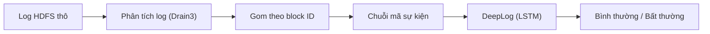

# Project III — Phát hiện bất thường trong log hệ thống bằng DeepLog (HDFS_v1)

Mục tiêu: parse log HDFS → tạo chuỗi sự kiện theo block → train DeepLog (LSTM)
→ phát hiện bất thường bằng luật top-g → so sánh với một phương pháp cổ điển (PCA / Isolation Forest).

**Trạng thái: tuần 1** — tìm hiểu đề tài và khảo sát bộ mẫu HDFS_2k bằng Drain3.
Ghi chú tìm hiểu (bài toán, DeepLog, HDFS_v1, phạm vi, các quyết định): [documents/TUAN1_TIM_HIEU.md](documents/TUAN1_TIM_HIEU.md).

Pipeline dự kiến:



## 1. Cấu trúc thư mục

```
project-3/
├── configs/
│   ├── config.yaml          # toàn bộ đường dẫn (đọc qua src/config.py)
│   └── drain3_basic.ini     # Drain3 cơ bản: chỉ che mã block, IP, con số
├── data/raw/HDFS_2k/        # bộ mẫu 2.000 dòng (tự tải về, không đưa lên GitHub)
├── documents/
│   └── TUAN1_TIM_HIEU.md    # TUẦN 1: ghi chú tìm hiểu tài liệu và bộ dữ liệu
├── src/
│   ├── config.py            # đọc config.yaml
│   ├── utils.py             # logger, JSON
│   └── explore_hdfs_2k.py   # TUẦN 1: khảo sát HDFS_2k bằng Drain3
├── outputs/
│   ├── figures/             # hình
│   └── results/             # file JSON/CSV kết quả
├── requirements.txt
└── README.md
```

## 2. Cài đặt

```bash
cd ~/project-3
python3 -m venv venv
source venv/bin/activate
pip install -r requirements.txt
```

## 3. Tải bộ mẫu HDFS_2k (từ GitHub `logpai/loghub`)

```bash
mkdir -p data/raw/HDFS_2k && cd data/raw/HDFS_2k
for f in HDFS_2k.log HDFS_2k.log_structured.csv HDFS_2k.log_templates.csv; do
  curl -sSfLO https://raw.githubusercontent.com/logpai/loghub/master/HDFS/$f
done
cd ../../..
```

## 4. Chạy khảo sát

```bash
python -m src.explore_hdfs_2k
```

Luôn chạy bằng `python -m src.<tên_module>` từ thư mục `~/project-3`, vì các file import nhau theo dạng `from src.xxx import ...`.

Kết quả:
- `outputs/results/hdfs2k_survey.json`: số dòng (kể cả số dòng không khớp regex), số dòng theo level, theo component, số template, số mã block
- `outputs/results/hdfs2k_templates.csv`: từng template Drain3, số dòng, EventId tương ứng của Loghub
- `outputs/figures/hdfs2k_template_freq.png`: tần suất các template

Kết quả đúng phải là:
- 2.000 dòng, không dòng nào lệch định dạng (`unmatched_lines` = 0): 1.920 INFO, 80 WARN
  (cả 80 dòng WARN đều là "Got exception while serving block"), 6 component
- Drain3 tìm được 16 template, đáp án Loghub có 14. Template E4 của Loghub ("BLOCK* ask ... to delete ...")
  bị tách thành 3 template vì số mã block trong dòng log khác nhau. Cần xử lý trước khi parse dữ liệu đầy đủ.
- 2.200 mã block khác nhau, 2.194 mã chỉ xuất hiện trong đúng 1 dòng. Bộ mẫu được lấy ngẫu nhiên theo dòng,
  nên không dựng được chuỗi theo block. Việc train và đánh giá phải dùng HDFS_v1 đầy đủ.

## 5. Kế hoạch

| Tuần | Công việc |
|---|---|
| 1 | Tìm hiểu DeepLog, HDFS_v1; khảo sát HDFS_2k bằng Drain3 |
| 2 | Tải HDFS_v1, parse bằng Drain3, dựng chuỗi theo block, chia dữ liệu theo thời gian, phương pháp cổ điển |
| 3 | Cài đặt và train DeepLog, tinh chỉnh g và h, phân tích lỗi |
| 4 | Script phát hiện; nếu kịp, thử trên AIT Log Data Set V2.0 |
| 5 | Báo cáo cuối kỳ, slide, demo |
