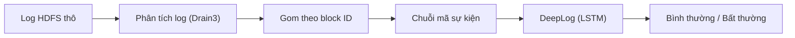

# Project III — Phát hiện bất thường trong log hệ thống bằng DeepLog (HDFS_v1)

Mục tiêu: parse log HDFS → tạo chuỗi sự kiện theo block → train DeepLog (LSTM)
→ phát hiện bất thường bằng luật top-g → so sánh với một phương pháp cổ điển (PCA / Isolation Forest).

**Trạng thái: tuần 3** — cài và huấn luyện DeepLog bằng PyTorch, phát hiện bất thường bằng luật top-g, chọn ngưỡng
của mọi phương pháp (g của DeepLog, PCA, Isolation Forest) theo cùng một cách trên tập tune, phân tích lỗi.
Tuần 2: parse HDFS_v1 bằng Drain3 (khớp 100% với Loghub), dựng chuỗi theo block, EDA, chia dữ liệu theo thời gian,
baseline PCA / Isolation Forest.
Ghi chú tìm hiểu tuần 1 (bài toán, DeepLog, HDFS_v1, phạm vi, các quyết định): [documents/TUAN1_TIM_HIEU.md](documents/TUAN1_TIM_HIEU.md).

Pipeline:



## 1. Cấu trúc thư mục

```
project-3/
├── configs/
│   ├── config.yaml          # toàn bộ đường dẫn + tham số (đọc qua src/config.py)
│   ├── drain3_basic.ini     # TUẦN 1: Drain3 cơ bản, chỉ che mã block, IP, con số
│   └── drain3.ini           # TUẦN 2: Drain3 đã chỉnh cho HDFS_v1 (29 template)
├── data/                    # không đưa lên GitHub
│   ├── raw/                 # HDFS_2k/, HDFS_v1/ (tự tải về, xem mục 3)
│   ├── interim/             # kết quả bước 1: log có cấu trúc, bảng template, block_stats.csv
│   └── processed/           # kết quả bước 2–3: sessions.pkl, event_index.json, splits/
├── documents/
│   └── TUAN1_TIM_HIEU.md    # TUẦN 1: ghi chú tìm hiểu tài liệu và bộ dữ liệu
├── notebooks/
│   └── 01_eda_hdfs.ipynb    # TUẦN 2: khám phá dữ liệu (EDA)
├── src/
│   ├── config.py            # đọc config.yaml
│   ├── utils.py             # seed, chọn device (MPS/CUDA/CPU), logger, JSON
│   ├── explore_hdfs_2k.py   # TUẦN 1: khảo sát HDFS_2k bằng Drain3
│   ├── parse_logs.py        # BƯỚC 1: parse log thô bằng Drain3
│   ├── build_sequences.py   # BƯỚC 2: gom sự kiện thành chuỗi theo block, gắn nhãn
│   ├── split_data.py        # BƯỚC 3: chia train / val / test
│   ├── dataset.py           # TUẦN 3: cửa sổ trượt h sự kiện + Dataset PyTorch (pad session ngắn)
│   ├── model.py             # TUẦN 3: mô hình DeepLog (Embedding → LSTM 2 lớp → Linear)
│   ├── train.py             # BƯỚC 4: train DeepLog, early stopping theo val loss
│   ├── detect.py            # BƯỚC 5: phát hiện bằng luật top-g
│   ├── baselines.py         # BƯỚC 6: PCA, Isolation Forest (ngưỡng mặc định)
│   ├── deeplog_scores.py    # BƯỚC 7a: rank của sự kiện thật ở mọi vị trí → kết quả của mọi g
│   ├── model_selection.py   # BƯỚC 7b: chọn phương án + ngưỡng trên tập tune, báo cáo trên tập eval
│   ├── evaluate.py          # precision / recall / F1, ROC-AUC, AP, recall theo nhóm, phân tích lỗi
│   ├── block_stats.py       # vị trí, thời gian, nhãn của từng block
│   └── validate_parsing.py  # so kết quả parse với đáp án Loghub
├── outputs/
│   ├── figures/             # hình
│   ├── models/              # checkpoint DeepLog (.pt), không đưa lên GitHub
│   └── results/             # file JSON/CSV kết quả
├── scripts/run_pipeline.sh  # chạy bước 1–7 + phân tích lỗi
├── requirements.txt
└── README.md
```

## 2. Cài đặt

```bash
cd ~/project-3
python3 -m venv venv
source venv/bin/activate
pip install -r requirements.txt
python -c "import torch; print(torch.__version__, 'MPS:', torch.backends.mps.is_available())"
```

Dòng cuối in `MPS: True` nghĩa là PyTorch dùng được GPU của Mac; nếu không, `train.device: auto` tự lùi về CUDA hoặc CPU.

## 3. Tải dữ liệu

**Bộ mẫu HDFS_2k** (khảo sát tuần 1, từ GitHub `logpai/loghub`):

```bash
mkdir -p data/raw/HDFS_2k && cd data/raw/HDFS_2k
for f in HDFS_2k.log HDFS_2k.log_structured.csv HDFS_2k.log_templates.csv; do
  curl -sSfLO https://raw.githubusercontent.com/logpai/loghub/master/HDFS/$f
done
cd ../../..
```

**Bộ đầy đủ HDFS_v1:** vào GitHub `logpai/loghub`, mục **HDFS**, theo link Zenodo để tải `HDFS_v1.zip`,
rồi giải nén vào `data/raw/HDFS_v1/`:

```bash
mkdir -p data/raw/HDFS_v1
unzip HDFS_v1.zip -d data/raw/HDFS_v1
ls -lh data/raw/HDFS_v1 data/raw/HDFS_v1/preprocessed
```

Cần có `HDFS.log` (~1,5GB, 11.175.629 dòng) và trong `preprocessed/`: `anomaly_label.csv` (nhãn của từng block),
`HDFS.log_templates.csv`, `Event_traces.csv`. Hai file sau là kết quả parse của Loghub, chỉ dùng để kiểm tra.

## 4. Chạy

Luôn chạy bằng `python -m src.<tên_module>` từ thư mục `~/project-3`, vì các file import nhau theo dạng `from src.xxx import ...`.

```bash
python -m src.explore_hdfs_2k   # TUẦN 1: khảo sát bộ mẫu
python -m src.parse_logs        # BƯỚC 1: parse HDFS.log bằng Drain3
python -m src.build_sequences   # BƯỚC 2: chuỗi sự kiện theo block
python -m src.block_stats       # ~10 giây, cần cho validate_parsing và notebook EDA
python -m src.validate_parsing  # so kết quả bước 1–2 với đáp án Loghub
python -m src.split_data        # BƯỚC 3: chia train / val / test
jupyter notebook notebooks/01_eda_hdfs.ipynb
python -m src.train             # BƯỚC 4: train DeepLog (~15 giây trên Mac M-series)
python -m src.detect            # BƯỚC 5: top-g với g = detect.top_g (thử nhanh: --max-sessions 20000)
python -m src.detect --top-g 7  # g khác, ghi ra deeplog_metrics_g7.json, deeplog_predictions_g7.pkl
python -m src.evaluate --top-g 7  # phân tích lỗi + recall theo 2 nhóm bất thường
python -m src.baselines         # BƯỚC 6: PCA và Isolation Forest
python -m src.deeplog_scores    # BƯỚC 7a: rank DeepLog → kết quả của mọi g, không chạy lại model
python -m src.model_selection --tune-mode earliest   # BƯỚC 7b (chạy cả --tune-mode random)
```

Hoặc chạy bước 1–7 và phân tích lỗi liên tiếp: `bash scripts/run_pipeline.sh`.

**Chạy thử nhanh:** trong `configs/config.yaml`, đặt `parse.max_lines: 200000` để chỉ parse 200 nghìn dòng đầu.
Khi mọi bước chạy thông suốt, đổi lại `max_lines: null` để chạy toàn bộ dữ liệu.

## 5. Kết quả đúng phải là

**Khảo sát HDFS_2k (tuần 1)** — `outputs/results/hdfs2k_survey.json`, `hdfs2k_templates.csv`, `outputs/figures/hdfs2k_template_freq.png`:
- 2.000 dòng, không dòng nào lệch định dạng: 1.920 INFO, 80 WARN, 6 component.
- Drain3 cơ bản tìm được 16 template, đáp án Loghub có 14 (template "BLOCK* ask ... to delete ..." bị tách theo số mã block).
- 2.194 trên 2.200 mã block chỉ có 1 dòng, nên bộ mẫu không dựng được chuỗi theo block.

**Parse HDFS_v1 (bước 1–2)** — `outputs/results/parsing_validation.json`, `drain_vs_reference.csv`:
- 11.175.629 dòng, 29 template (khớp 29 template của Loghub), `grouping_accuracy = 1.0`.
- 575.061 block (16.838 bất thường), chuỗi sự kiện khớp chính xác `Event_traces.csv` ở cả 575.061 block (`match_rate = 1.0`).
- Vì kết quả parse khớp hoàn toàn, không cần phương án dự phòng (dùng chuỗi đã tiền xử lý của Loghub) ở mục 8 báo cáo tuần 1.
- Nếu `parse_logs` cho kết quả khác thì lỗi nằm ở code parse, không phải ở cấu hình Drain3.
- So với `drain3_basic.ini` (45 template, grouping accuracy 0,85), `drain3.ini` che thêm exception, đường dẫn file,
  danh sách IP và tăng `sim_th` lên 0,9 (giải thích trong file).

**Chia dữ liệu (bước 3)** — `data/processed/splits/summary.json`:
- train 5.024 + val 558 session, toàn bộ là Normal: 1% session Normal *sớm nhất*, thực tế chỉ là 9 phút log đầu
  (20:35 → 20:45 ngày 09/11/2008).
- test 569.276 session (16.635 bất thường), kéo dài khoảng 38,5 giờ. 203 session bất thường bắt đầu trước mốc cắt bị bỏ,
  để test chỉ chứa "tương lai".
- Notebook EDA giải thích vì sao chọn cách chia này và các đặc điểm của dữ liệu (độ dài session, bất thường theo thời gian,
  sự kiện chỉ có ở session bất thường, chuỗi trùng lặp). Hình lưu ở `outputs/figures/eda_*.png`.

**Baseline (bước 6)** — `outputs/results/baselines.json`. Mỗi phương pháp được fit theo 2 cách: trên session Normal của
train + val (cùng dữ liệu DeepLog sẽ dùng), hoặc trên 10% session sớm nhất của test **bỏ nhãn** (log không nhãn,
3,5 giờ ngay sau train). Cả 4 cách chấm trên cùng tập eval: 90% test còn lại (512.348 session, 14.027 bất thường).

| Phương pháp | Fit trên | Precision | Recall | F1 | ROC-AUC | AP |
|---|---|---|---|---|---|---|
| PCA | session Normal | 0,747 | 0,830 | 0,786 | 0,932 | 0,810 |
| PCA | log không nhãn | 0,172 | 0,753 | 0,280 | 0,902 | 0,507 |
| Isolation Forest | session Normal | 0,028 | 0,987 | 0,054 | 0,578 | 0,112 |
| Isolation Forest | log không nhãn | 0,936 | 0,537 | 0,683 | 0,977 | 0,865 |

- ROC-AUC, AP không phụ thuộc ngưỡng (AUC = 0,5 là đoán mò). P/R/F1 dùng ngưỡng mặc định, chưa chỉnh theo nhãn.
- Isolation Forest fit trên session Normal gần như đoán mò: cây chỉ cắt được trên 12/29 loại sự kiện có thay đổi trong
  train, trong khi 60% session bất thường chứa sự kiện chưa từng xuất hiện trong train (mục `diagnostics`).
- PCA thì ngược lại: TF-IDF cho sự kiện chưa từng thấy trọng số rất lớn, nên fit trên session Normal cho kết quả tốt nhất.

**Train DeepLog (bước 4)** — `outputs/models/deeplog_best.pt`, `outputs/results/train_history.json`:
- Mô hình theo bài báo: cửa sổ h = 10, Embedding 32 chiều → LSTM 2 lớp × 64 đơn vị → Linear 30 lớp (29 sự kiện + PAD),
  61.278 tham số. Session có ≤ h sự kiện được thêm PAD vào đầu nên vẫn có 1 cửa sổ (notebook EDA, Phần 2).
- 80.619 cặp (cửa sổ, sự kiện kế tiếp) từ 5.024 session train, 8.329 cặp từ 558 session val.
- Adam, lr = 0,001, batch 512, seed 42. Early stopping dừng ở epoch 11; val loss thấp nhất 0,210 ở epoch 6.

**Phát hiện top-g (bước 5)** — `outputs/results/deeplog_metrics_g{g}.json` (toàn bộ test, 569.276 session):

| g | Precision | Recall | F1 | FP | FN |
|---|---|---|---|---|---|
| 5 | 0,708 | 0,998 | 0,829 | 6.832 | 30 |
| 7 | 0,847 | 0,993 | 0,914 | 2.985 | 122 |
| 9 (bài báo) | 0,839 | 0,861 | 0,850 | 2.754 | 2.311 |
| 11 | 0,838 | 0,747 | 0,790 | 2.400 | 4.208 |
| 15 | 0,910 | 0,596 | 0,720 | 984 | 6.719 |

- Bảng chỉ để xem độ nhạy theo g; g dùng để báo cáo được chọn trên tập tune ở bước 7 (không chọn theo F1 trên test).
- Phân tích lỗi ở g = 7 (`python -m src.evaluate --top-g 7` → `error_analysis_g7.csv`):
  119/122 FN chứa sự kiện chưa từng có trong train (chủ yếu E15 "Receiving empty packet") nhưng chỉ nằm trong 10 sự kiện
  đầu, phần mà cách cắt cửa sổ của DeepLog không bao giờ dự đoán. 1.778/2.985 FP là session Normal có nhân bản lại block
  (E6–E9; chỉ 1/5.582 session train có); trong số còn lại, 218 FP chứa sự kiện chưa từng thấy (chủ yếu E23) và 269 FP
  bị đọc (E10) từ 4 lần trở lên, trong khi trung vị ở train là 1.

**Chọn phương án công bằng (bước 7)** — `outputs/results/model_selection_{earliest,random}.json`.
Test chia làm tập tune (10%, có nhãn, chỉ để chọn phương án và ngưỡng) và tập eval (90%, 512.348 session, chỉ để báo cáo).
Ngưỡng của MỌI phương pháp là ngưỡng cho F1 cao nhất trên tune; điểm của DeepLog là rank lớn nhất của sự kiện thật
trong session, nên "max rank > g" chính là luật top-g. F1 trên eval (seed 42):

| Phương pháp | Fit trên | Tune ngẫu nhiên | Tune sớm nhất |
|---|---|---|---|
| DeepLog (g chọn được = 7 ở cả hai) | 5.582 session Normal | 0,915 | 0,903 |
| PCA | 5.582 session Normal | 0,848 | 0,172 |
| PCA | tập tune, không dùng nhãn | 0,973* | 0,213 |
| Isolation Forest | 5.582 session Normal | 0,258 | 0,254 |
| Isolation Forest | tập tune, không dùng nhãn | 0,713 | 0,829 |

\* Tập tune ngẫu nhiên rải khắp thời gian test, nên phương án này đã thấy log (không nhãn) của tương lai: chỉ là cận trên.

- Cùng dữ liệu fit và tune ngẫu nhiên (seed 42): DeepLog 0,915, PCA 0,848. Tune trên 3,5 giờ đầu: ngưỡng PCA không dùng
  được về sau (báo nhầm hơn 100 nghìn session), còn g = 7 của DeepLog vẫn dùng được.
- DeepLog có ROC-AUC 0,997 trên eval, cao nhất trong các phương án hợp lệ về thời gian.
- Recall theo 2 nhóm bất thường của EDA (`recall_structural` / `recall_sequence`): DeepLog 0,988 / 0,997;
  PCA fit trên Normal 0,569 / 0,996 (bỏ sót toàn bộ 2.601 session chỉ có `E2 E1` hoặc `E1 E2`).
- Theo seed (đổi `seed` trong config, chạy lại bước 4 và 7; seed 42, 1, 2, 3, 4): F1 của DeepLog 0,846 ± 0,053 khi tune
  ngẫu nhiên và 0,845 ± 0,048 khi tune sớm nhất (từ 0,79 đến 0,91). Khi tune sớm nhất, DeepLog giữ F1 ≥ 0,79 ở cả 5 seed,
  còn PCA chỉ đạt 0,172. Tuần 4 sẽ giảm độ dao động này.

## 6. Kế hoạch

| Tuần | Công việc |
|---|---|
| 1 | Tìm hiểu DeepLog, HDFS_v1; khảo sát HDFS_2k bằng Drain3 |
| 2 | Tải HDFS_v1, parse bằng Drain3, dựng chuỗi theo block, chia dữ liệu theo thời gian, phương pháp cổ điển |
| 3 | Cài đặt và train DeepLog, chọn g và ngưỡng của mọi phương pháp trên tập tune, phân tích lỗi (đã xong) |
| 4 | Độ ổn định theo seed; xử lý các điểm mù của DeepLog tìm được ở phân tích lỗi; đánh giá theo số cảnh báo giả mỗi giờ, độ trễ phát hiện, drift; đối chứng chia random |
| 5 | Báo cáo cuối kỳ, slide, demo |
