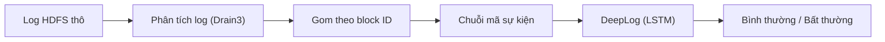

# Project III — Phát hiện bất thường trong log hệ thống bằng DeepLog (HDFS_v1)

Mục tiêu: parse log HDFS → tạo chuỗi sự kiện theo block → train DeepLog (LSTM)
→ phát hiện bất thường bằng luật top-g → so sánh với một phương pháp cổ điển (PCA / Isolation Forest).

**Trạng thái: tuần 1** — khởi tạo khung project.

Pipeline dự kiến:



## 1. Cấu trúc thư mục

```
project-3/
├── configs/
│   └── config.yaml          # toàn bộ đường dẫn (đọc qua src/config.py)
├── src/
│   ├── config.py            # đọc config.yaml
│   └── utils.py             # logger, JSON
├── outputs/
│   ├── figures/             # hình
│   └── results/             # file JSON/CSV kết quả
├── requirements.txt
└── README.md
```

## 2. Cài đặt

```bash
cd ~/project-3
python3 -m venv venv
source venv/bin/activate
pip install -r requirements.txt
```

## 3. Kế hoạch

| Tuần | Công việc |
|---|---|
| 1 | Tìm hiểu DeepLog, HDFS_v1; khảo sát HDFS_2k bằng Drain3 |
| 2 | Tải HDFS_v1, parse bằng Drain3, dựng chuỗi theo block, chia dữ liệu theo thời gian, phương pháp cổ điển |
| 3 | Cài đặt và train DeepLog, tinh chỉnh g và h, phân tích lỗi |
| 4 | Script phát hiện; nếu kịp, thử trên AIT Log Data Set V2.0 |
| 5 | Báo cáo cuối kỳ, slide, demo |
