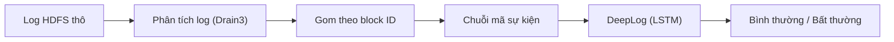

# Project III — Phát hiện bất thường trong log hệ thống bằng DeepLog (HDFS_v1)

Mục tiêu: parse log HDFS → tạo chuỗi sự kiện theo block → train DeepLog (LSTM)
→ phát hiện bất thường bằng luật top-g → so sánh với một phương pháp cổ điển (PCA / Isolation Forest).

**Trạng thái: tuần 2** — parse toàn bộ HDFS_v1 bằng Drain3 (khớp 100% với đáp án Loghub), dựng chuỗi sự kiện
theo block, khám phá dữ liệu (EDA), chia dữ liệu theo thời gian và chạy baseline PCA / Isolation Forest.
Ghi chú tìm hiểu tuần 1 (bài toán, DeepLog, HDFS_v1, phạm vi, các quyết định): [documents/TUAN1_TIM_HIEU.md](documents/TUAN1_TIM_HIEU.md).

Pipeline dự kiến:



## 1. Cấu trúc thư mục

```
project-3/
├── configs/
│   ├── config.yaml          # toàn bộ đường dẫn + tham số (đọc qua src/config.py)
│   ├── drain3_basic.ini     # TUẦN 1: Drain3 cơ bản, chỉ che mã block, IP, con số
│   └── drain3.ini           # TUẦN 2: Drain3 đã chỉnh cho HDFS_v1 (29 template)
├── data/                    # không đưa lên GitHub
│   ├── raw/                 # HDFS_2k/, HDFS_v1/ (tự tải về, xem mục 3)
│   ├── interim/             # kết quả bước 1: log có cấu trúc, bảng template, block_stats.csv
│   └── processed/           # kết quả bước 2–3: sessions.pkl, event_index.json, splits/
├── documents/
│   └── TUAN1_TIM_HIEU.md    # TUẦN 1: ghi chú tìm hiểu tài liệu và bộ dữ liệu
├── notebooks/
│   └── 01_eda_hdfs.ipynb    # TUẦN 2: khám phá dữ liệu (EDA)
├── src/
│   ├── config.py            # đọc config.yaml
│   ├── utils.py             # logger, tạo thư mục, JSON
│   ├── explore_hdfs_2k.py   # TUẦN 1: khảo sát HDFS_2k bằng Drain3
│   ├── parse_logs.py        # BƯỚC 1: parse log thô bằng Drain3
│   ├── build_sequences.py   # BƯỚC 2: gom sự kiện thành chuỗi theo block, gắn nhãn
│   ├── split_data.py        # BƯỚC 3: chia train / val / test
│   ├── baselines.py         # BƯỚC 6: PCA, Isolation Forest
│   ├── evaluate.py          # precision / recall / F1, ROC-AUC, AP
│   ├── block_stats.py       # vị trí, thời gian, nhãn của từng block
│   └── validate_parsing.py  # so kết quả parse với đáp án Loghub
├── outputs/
│   ├── figures/             # hình
│   └── results/             # file JSON/CSV kết quả
├── requirements.txt
└── README.md
```

Bước 4–5 (train DeepLog, phát hiện bằng luật top-g) làm ở tuần 3.

## 2. Cài đặt

```bash
cd ~/project-3
python3 -m venv venv
source venv/bin/activate
pip install -r requirements.txt
```

## 3. Tải dữ liệu

**Bộ mẫu HDFS_2k** (khảo sát tuần 1, từ GitHub `logpai/loghub`):

```bash
mkdir -p data/raw/HDFS_2k && cd data/raw/HDFS_2k
for f in HDFS_2k.log HDFS_2k.log_structured.csv HDFS_2k.log_templates.csv; do
  curl -sSfLO https://raw.githubusercontent.com/logpai/loghub/master/HDFS/$f
done
cd ../../..
```

**Bộ đầy đủ HDFS_v1:** vào GitHub `logpai/loghub`, mục **HDFS**, theo link Zenodo để tải `HDFS_v1.zip`,
rồi giải nén vào `data/raw/HDFS_v1/`:

```bash
mkdir -p data/raw/HDFS_v1
unzip HDFS_v1.zip -d data/raw/HDFS_v1
ls -lh data/raw/HDFS_v1 data/raw/HDFS_v1/preprocessed
```

Cần có `HDFS.log` (~1,5GB, 11.175.629 dòng) và trong `preprocessed/`: `anomaly_label.csv` (nhãn của từng block),
`HDFS.log_templates.csv`, `Event_traces.csv`. Hai file sau là kết quả parse của Loghub, chỉ dùng để kiểm tra.

## 4. Chạy

Luôn chạy bằng `python -m src.<tên_module>` từ thư mục `~/project-3`, vì các file import nhau theo dạng `from src.xxx import ...`.

```bash
python -m src.explore_hdfs_2k   # TUẦN 1: khảo sát bộ mẫu
python -m src.parse_logs        # BƯỚC 1: parse HDFS.log bằng Drain3
python -m src.build_sequences   # BƯỚC 2: chuỗi sự kiện theo block
python -m src.block_stats       # ~10 giây, cần cho validate_parsing và notebook EDA
python -m src.validate_parsing  # so kết quả bước 1–2 với đáp án Loghub
python -m src.split_data        # BƯỚC 3: chia train / val / test
jupyter notebook notebooks/01_eda_hdfs.ipynb
python -m src.baselines         # BƯỚC 6: PCA và Isolation Forest
```

**Chạy thử nhanh:** trong `configs/config.yaml`, đặt `parse.max_lines: 200000` để chỉ parse 200 nghìn dòng đầu.
Khi mọi bước chạy thông suốt, đổi lại `max_lines: null` để chạy toàn bộ dữ liệu.

## 5. Kết quả đúng phải là

**Khảo sát HDFS_2k (tuần 1)** — `outputs/results/hdfs2k_survey.json`, `hdfs2k_templates.csv`, `outputs/figures/hdfs2k_template_freq.png`:
- 2.000 dòng, không dòng nào lệch định dạng: 1.920 INFO, 80 WARN, 6 component.
- Drain3 cơ bản tìm được 16 template, đáp án Loghub có 14 (template "BLOCK* ask ... to delete ..." bị tách theo số mã block).
- 2.194 trên 2.200 mã block chỉ có 1 dòng, nên bộ mẫu không dựng được chuỗi theo block.

**Parse HDFS_v1 (bước 1–2)** — `outputs/results/parsing_validation.json`, `drain_vs_reference.csv`:
- 11.175.629 dòng, 29 template (khớp 29 template của Loghub), `grouping_accuracy = 1.0`.
- 575.061 block (16.838 bất thường), chuỗi sự kiện khớp chính xác `Event_traces.csv` ở cả 575.061 block (`match_rate = 1.0`).
- Vì kết quả parse khớp hoàn toàn, không cần phương án dự phòng (dùng chuỗi đã tiền xử lý của Loghub) ở mục 8 báo cáo tuần 1.
- Nếu `parse_logs` cho kết quả khác thì lỗi nằm ở code parse, không phải ở cấu hình Drain3.
- So với `drain3_basic.ini` (45 template, grouping accuracy 0,85), `drain3.ini` che thêm exception, đường dẫn file,
  danh sách IP và tăng `sim_th` lên 0,9 (giải thích trong file).

**Chia dữ liệu (bước 3)** — `data/processed/splits/summary.json`:
- train 5.024 + val 558 session, toàn bộ là Normal: 1% session Normal *sớm nhất*, thực tế chỉ là 9 phút log đầu
  (20:35 → 20:45 ngày 09/11/2008).
- test 569.276 session (16.635 bất thường), kéo dài khoảng 38,5 giờ. 203 session bất thường bắt đầu trước mốc cắt bị bỏ,
  để test chỉ chứa "tương lai".
- Notebook EDA giải thích vì sao chọn cách chia này và các đặc điểm của dữ liệu (độ dài session, bất thường theo thời gian,
  sự kiện chỉ có ở session bất thường, chuỗi trùng lặp). Hình lưu ở `outputs/figures/eda_*.png`.

**Baseline (bước 6)** — `outputs/results/baselines.json`. Mỗi phương pháp được fit theo 2 cách: trên session Normal của
train + val (cùng dữ liệu DeepLog sẽ dùng), hoặc trên 10% session sớm nhất của test **bỏ nhãn** (log không nhãn,
3,5 giờ ngay sau train). Cả 4 cách chấm trên cùng tập eval: 90% test còn lại (512.348 session, 14.027 bất thường).

| Phương pháp | Fit trên | Precision | Recall | F1 | ROC-AUC | AP |
|---|---|---|---|---|---|---|
| PCA | session Normal | 0,747 | 0,830 | 0,786 | 0,932 | 0,810 |
| PCA | log không nhãn | 0,172 | 0,753 | 0,280 | 0,902 | 0,507 |
| Isolation Forest | session Normal | 0,028 | 0,987 | 0,054 | 0,578 | 0,112 |
| Isolation Forest | log không nhãn | 0,936 | 0,537 | 0,683 | 0,977 | 0,865 |

- ROC-AUC, AP không phụ thuộc ngưỡng (AUC = 0,5 là đoán mò). P/R/F1 dùng ngưỡng mặc định, chưa chỉnh theo nhãn.
- Isolation Forest fit trên session Normal gần như đoán mò: cây chỉ cắt được trên 12/29 loại sự kiện có thay đổi trong
  train, trong khi 60% session bất thường chứa sự kiện chưa từng xuất hiện trong train (mục `diagnostics`).
- PCA thì ngược lại: TF-IDF cho sự kiện chưa từng thấy trọng số rất lớn, nên fit trên session Normal cho kết quả tốt nhất.

## 6. Kế hoạch

| Tuần | Công việc |
|---|---|
| 1 | Tìm hiểu DeepLog, HDFS_v1; khảo sát HDFS_2k bằng Drain3 |
| 2 | Tải HDFS_v1, parse bằng Drain3, dựng chuỗi theo block, chia dữ liệu theo thời gian, phương pháp cổ điển |
| 3 | Cài đặt và train DeepLog, tinh chỉnh g và h, phân tích lỗi |
| 4 | Script phát hiện; nếu kịp, thử trên AIT Log Data Set V2.0 |
| 5 | Báo cáo cuối kỳ, slide, demo |
